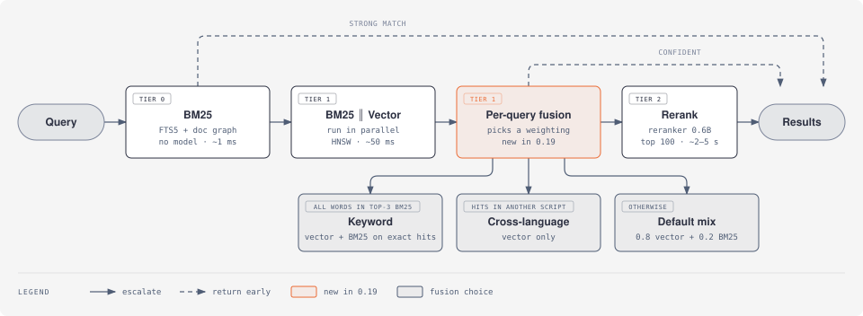
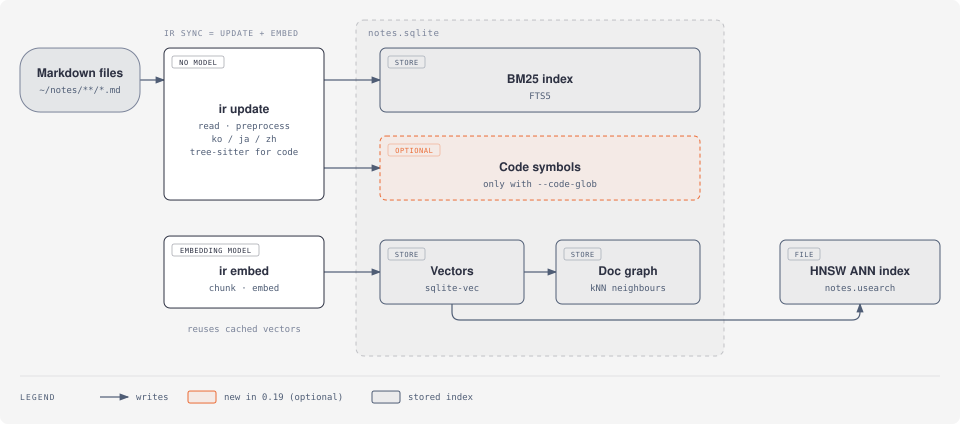

# ir

[](https://crates.io/crates/ir-search)
[](https://github.com/vlwkaos/ir/actions/workflows/ci.yml)
[](https://github.com/vlwkaos/ir/actions/workflows/ci-evaluation.yml)
[](LICENSE)

[ENG](README.md) | [한국어](README.ko.md) | [中文](README.zh.md)

面向多语言混合 Markdown 知识库的本地检索。BM25 + 向量 + LLM 重排序，全部在本机运行——每个集合一个 SQLite 文件，持久化守护进程保持模型热加载，所有 LLM 输出均被缓存。还可以选择在笔记旁索引源代码，作为辅助证据。

```bash
brew install vlwkaos/tap/ir          # macOS
cargo install ir-search              # 任意平台（二进制名：ir）
```

```bash
ir collection add notes ~/notes      # 注册集合
ir sync notes                        # 索引文本 + 嵌入向量
ir search "memory safety in rust"    # 搜索（守护进程自动启动）
```

BM25 检索无需任何模型。向量/混合检索在首次使用时自动从 HuggingFace 下载模型。从源码构建需要 Rust 1.80 及以上；macOS 上自动链接 Metal，Linux GPU 后端为可选启用（`--features llama-cuda|llama-rocm|llama-vulkan`）。

## 0.19 新功能

| 功能 | 需要做什么 |
|---|---|
| 用一种语言提问，找到另一种语言的笔记 | 无需操作（hybrid 或 vector 模式）。现有集合无需重新索引。 |
| 代码帮助相关笔记排得更靠前 | 添加 `--code-glob 'src/**/*.rs'`。见[文档](#文档)中的**代码域**。 |
| 在文档之后查看匹配的代码 | `ir search "…" --aux`（MCP `aux: ["all"]`） |
| 更快的混合搜索（中位数 ~67 → 50 ms） | 无需操作。 |

## 检索流程 — 只为困难查询付出代价

三层。每层**仅在上一层信心不足时**才运行，因此大多数查询在第 0 或第 1 层就返回，不触及 LLM。单个热守护进程将所有模型常驻内存，所有 LLM 输出都缓存在 SQLite 中。

<picture>
  <source media="(prefers-color-scheme: dark)" srcset="docs/img/search-pipeline-dark.svg">
  
</picture>

按查询选择融合方式，既让关键词查找保持精确，也让问题能找到用另一种语言写成的答案：英文问题可以匹配韩文笔记，反过来也一样。

| 查询（示例） | 第 1 层看到的情况 | 融合方式 |
|---|---|---|
| `rustls 0.23.46` | BM25 前 3 个段落中有一个包含全部查询词 | 向量，并只给这些段落加 BM25 分 |
| 对韩文笔记查询 `how long are logs kept?` | 最佳向量结果是韩文，查询是拉丁字母 | 仅向量 |
| 对英文笔记查询 `memory safety in rust` | 以上都不是 | 0.8 · vector + 0.2 · BM25 |

查询词指小写拉丁单词和连续数字，以及中日韩文字的二字组。`ir search -v` 会以 `[fusion]` 行输出所选方式。

### `ir sync` 构建的内容

<picture>
  <source media="(prefers-color-scheme: dark)" srcset="docs/img/index-lifecycle-dark.svg">
  
</picture>

`ir sync` 运行这两步。再次运行只处理有变化的文件。

预处理器是中日韩 BM25 检索成败的关键：它对索引文本和查询做相同的形态素切分，没有它 CJK BM25 分数接近零。

**冷启动 vs 热启动**（M4 Max）：首次查询约 3.0 秒（守护进程加载模型），之后每次查询约 30ms 往返——即使在冷启动期间 BM25 也即时响应。检索管线的各项设置可在[高级配置](#高级配置)中按集合调整。

## 实测质量（nDCG@10）

每一列是**查询在该阶段停止时**的得分。`BM25` 和 `Vector` 是单信号基线；`Hybrid` 是第 1 层；`+ Rerank` 在前 100 个候选上加入 0.6B 重排序器（第 2 层）。LLM 扩展器**默认关闭**。

| 语料库 | BM25 | Vector | Hybrid | + Rerank |
|---|---|---|---|---|
| NFCorpus（英文，3.6k 文档，323 查询） | 0.31 | 0.39 | 0.39 | 0.40 |
| FiQA（英文，57.6k 文档，648 查询） | 0.24 | 0.40 | 0.40 | **0.44** |
| MIRACL-ko 50k（韩文，213 查询） | 0.73 | — | 0.92 | **0.96** |
| Allganize RAG-eval-KO（韩文，1.4k 页，298 查询） | 0.70 | — | 0.69 | 0.72 |
| 中日韩英混合，跨语言问题（19k 段落，200 查询） | ≈ 0 | 0.78 | **0.78** | **0.80** |
| **中位延迟**（热启动，M 系列） | ~1 ms | ~50 ms | ~50–280 ms | ~2–5 s |

跨语言问题是指：用英文提问韩文、日文或中文段落，以及用韩文提问英文段落，混合在同一个语料库（MIRACL）中。此前固定的 `0.8 · vector + 0.2 · BM25` 融合在这里只有 **0.21**（加重排序器为 0.71）：BM25 把同语言的近似错误结果抬到了正确答案之上。上面的单语言结果不受按查询融合影响（变化在 ±0.003 以内）。第 0 层还会运行 **doc-graph 扩展**，在稀疏语料（NFCorpus）上带来 ≈ +0.02，在稠密语料（FiQA）上则~中性。韩文 BM25 需要 `ko` 预处理器（否则 ≈ 0）；韩文 `Vector` 未在此重新测量（—）。方法与数据见 [research/adr-0002-per-query-fusion.md](research/adr-0002-per-query-fusion.md)。

## 版本速览

- **≤ 0.15** — 核心管线、守护进程、MCP、CJK 预处理器。
- **0.16** — `ir sync`（一条命令完成索引 + 嵌入）；已删除的文件会被移除，被移动的内容复用缓存的向量。
- **0.17** — 可选的研究路径：文档图和 HNSW ANN 索引。
- **0.18** — 这些路径成为默认（HNSW ANN、第 0 层图扩展、重排序窗口 100）；LLM 查询扩展器交给调用方 agent。[ADR-0001](research/adr-0001-default-retrieval-pipeline.md)。
- **0.19** — 面向多语言集合的按查询混合融合、并行的第 1 层、代码域、重写的 `--help`。[ADR-0002](research/adr-0002-per-query-fusion.md)。现有集合无需重新索引即可继续使用。

## 文档

<details>
<summary><strong>模型</strong></summary>

模型在首次使用时从 HuggingFace Hub 自动下载（缓存：`~/.cache/huggingface/`）。`HF_HUB_OFFLINE=1` 可禁用下载。

| 模型 | 用途 |
|---|---|
| [EmbeddingGemma 300M](https://huggingface.co/ggml-org/embeddinggemma-300M-GGUF) | 向量 / 混合检索 |
| [Qwen3-Reranker 0.6B](https://huggingface.co/ggml-org/Qwen3-Reranker-0.6B-Q8_0-GGUF) | 重排序（可选） |
| [qmd-query-expansion 1.7B](https://huggingface.co/tobil/qmd-query-expansion-1.7B) | 查询扩展（可选） |
| [BGE-M3](https://huggingface.co/ggml-org/bge-m3-Q8_0-GGUF) | 韩语优化的嵌入替代方案 |

**本地模型 / 覆盖：**

```bash
export IR_MODEL_DIRS="$HOME/my-models"
export IR_EMBEDDING_MODEL="$HOME/my-models/embeddinggemma-300M-Q8_0.gguf"
export IR_RERANKER_MODEL="$HOME/my-models/qwen3-reranker-0.6b-q8_0.gguf"
export IR_EXPANDER_MODEL="$HOME/my-models/qmd-query-expansion-1.7B-q4_k_m.gguf"
```

`IR_*_MODEL` 接受 `.gguf` 路径、包含已知模型的目录或 HuggingFace 仓库 ID。搜索顺序：环境变量 → `IR_MODEL_DIRS` → `~/local-models/` → `~/.cache/ir/models/` → HF Hub。`IR_COMBINED_MODEL`（单模型同时负责扩展+重排序）仅供实验用途。切换嵌入模型后需运行 `ir embed --force`。

**配置目录：**

```bash
export IR_CONFIG_DIR="~/vault/.config/ir"   # 可跨设备；支持 ~ 和 $VAR
```

优先级：`IR_CONFIG_DIR` → `XDG_CONFIG_HOME/ir`（已废弃）→ `~/.config/ir`。

**GPU：** `IR_GPU_LAYERS=0` 强制 CPU；`IR_GPU_LAYERS=N` 部分卸载。

</details>

<details>
<summary><strong>使用方法</strong></summary>

**集合与索引：**

```bash
ir collection add notes ~/notes
ir collection ls
ir collection rm notes
ir status                    # 各集合索引状态

ir sync [notes] [--force]    # 文本索引 + 嵌入（默认维护命令）
ir update [notes] [--force]  # 仅文本索引——快速，无需模型
ir embed [notes] [--force]   # 向量修复 / 重新嵌入
```

索引为增量式、内容寻址（SHA-256）：仅重新处理变更文件，相同内容去重，已删除文件被移除，移动/恢复的内容复用缓存向量而无需重新推理。

`ir update` 会输出集合路径、扫描到的文件数，以及仍然没有向量的文档数：

```
updating 'notes' (/Users/me/notes)…
  321 scanned: 1 added, 0 updated, 0 deactivated
  1 pending embedding (run `ir embed` or `ir sync`)
```

`0 scanned` 表示路径或 glob 没有匹配到任何文件。`ir update --force` 会重建文本索引并删除该集合已存储的向量，因此在运行 `ir embed` 或 `ir sync` 之前，所有文档都处于待嵌入状态。

如果集合的预处理器无法启动或在运行中停止，`ir update` 会给出警告并按原文建立索引，因此所有文件仍可被搜索。预处理器恢复后，下一次 `ir update` 会重新索引这些文件。多个 `ir` 进程（CLI 运行、MCP 服务器）可以同时更新同一个集合。当另一个进程正在嵌入同一个集合时，`ir sync` 和 `ir embed` 会等待。

**搜索：**

```bash
ir search "memory safety in rust"                 # 混合（默认）
ir search "sqlite architecture" --mode bm25       # 无需模型
ir search "async patterns" --mode vector
ir search "error handling" -c notes --min-score 0.4

ir search "ownership" --json | --md | --files | --full | --chunk | --quiet
ir search "design" -f "modified_at>=2026-01-01" -f "meta.tags=rust"
ir search "token refresh" --aux                  # 同时返回代码符号，排在文档之后
```

查询和文档可以使用不同的语言：英文问题在 `hybrid` 和 `vector` 模式下可以找到韩文笔记。`bm25` 只匹配词。

过滤条件（`-f`，可重复，AND 连接）：字段 `path`、`modified_at`、`created_at`、`meta.<name>`；运算符 `=` `!=` `>` `>=` `<` `<=` `~` `!~`。日期规范化为 UTC RFC3339。多值前言字段只要**任意**一个元素满足条件即匹配（包括 `!=`）。

**检索文档：**

```bash
ir get "2026/Daily/2026-04-07.md"              # 精确 → 后缀 → 子串匹配
ir get "2026-04-07" -c periodic --section "Log" --max-chars 3000
ir multi-get "a.md" "b.md" --json               # {found, not_found}
```

**守护进程：**

```bash
ir daemon start|stop|status   # 首次搜索时自动启动
```

热启动查询经 Unix 套接字往返约 30ms。冷启动时首个查询可在模型后台加载期间立即返回 BM25 结果。

升级 `ir` 之后，下一次搜索会自动替换由旧二进制启动的守护进程，该次查询按冷启动方式返回结果。Homebrew 和 `cargo install` 可在 `ir` 运行时升级。如果手动复制二进制文件，请替换文件（`mv` 或 `install`），不要直接覆盖写入：Linux 拒绝写入正在运行的程序（"Text file busy"）。`--mode bm25` 搜索不会启动或连接守护进程。守护进程在 120 秒内没有应答时，搜索停止等待并返回已有的结果。

</details>

<details>
<summary><strong>韩文 / 日文 / 中文预处理器</strong></summary>

CJK 文本在 BM25 前需要形态学分词——否则黏着词形永远无法匹配词素级查询（韩文 BM25 从 ~0.00 提升到可用水平）。索引时和查询时使用相同的预处理器。

```bash
ir preprocessor install ko    # lindera + ko-dic（官方二进制；macOS/Linux）
ir preprocessor install ja    # lindera + ipadic
ir preprocessor install zh    # lindera + jieba
ir preprocessor bind ko wiki  # 绑定到集合并重新索引
```

绑定 `ko` 时还会为该集合写入实测的韩文 routing 默认值（`fused_strong_product: 0.05`）；显式 `routing:` 配置始终优先。集合级 routing 覆盖（`fused_strong_floor/product`、`bm25_strong_floor/gap`）位于 `config.yml`，仅在所有被检索集合一致时生效。

任何可执行文件都可以作为预处理器：stdin 输入 UTF-8 行 → stdout 输出 0 或 1 行分词结果，进程在行间保持存活，仅含 ASCII 的单词原样传递。lindera 吞吐量：M 系列上约 5,600 韩文文档/秒。

**为什么重要**（MIRACL-Korean）：

| 预处理器 | BM25 nDCG@10 |
|---|---|
| 无 | 0.00 |
| lindera（`ko`） | 0.73（50k 文档抽样） |

</details>

<details>
<summary><strong>代码域 — 以源代码作为辅助证据</strong></summary>

在笔记旁边为源代码建立索引。代码本身不会成为搜索结果，它会提升提到它的笔记的排名。

**1. 为集合添加代码**

```bash
ir collection add notes ~/project --glob 'docs/**/*.md' --code-glob 'src/**/*.rs'
ir sync notes
```

对于已有的集合，在 `config.yml` 中加入 `auxiliary:`，然后运行 `ir update notes`：

```yaml
collections:
  - name: notes
    path: ~/project
    auxiliary:
      code:
        globs: ["src/**/*.rs", "src/**/*.py"]
        excludes: ["src/generated/**"]   # 可选
```

**2. 照常搜索**

```bash
ir search "drop outdated values after a migration" --json
```

提到匹配函数或文件的笔记排名会上升。结果的 `evidence` 字段说明原因：`["code:src/cache.rs:invalidate_entry"]`。

**3. 链接笔记中没有提到名字的代码**

| 位置 | 写法 |
|---|---|
| 笔记 frontmatter | `code: [src/keys.rs:rotate_all, src/ledger.rs, parse_config]` |
| 代码注释（作用于整个文件） | `// knowledge: design/ledger.md` 或 `// [[Ledger design]]` |

`ir update` 会对没有匹配任何内容的链接给出警告（例如重命名之后）。

**4. 同时查看代码本身（可选）**

```bash
ir search "rotate keys" --aux        # 先列出所有文档，再列出匹配的代码
```

MCP：`aux: ["all"]`。代码结果带有 `"kind": "code"`；`-f` 过滤只作用于文档。

参考：
- 语言：`.rs`、`.py`、`.js`/`.jsx`/`.mjs`/`.cjs`、`.ts`/`.tsx`、`.go`。索引签名和文档注释，不索引函数体。
- 笔记用 `snake_case`、`camelCase`、至少两段的 `PascalCase` 或反引号中的名字指向符号，用路径或唯一的路径后缀（`db/schema.rs`）指向文件。
- 只有覆盖查询中至少一半词语的代码匹配才会计入。
- `ir status` 和 MCP `status` 只对含代码的集合显示 `aux: code N`。对包含源文件的文件夹运行 `ir collection add` 时会输出一次提示。
- 删除 `auxiliary:` 并运行 `ir update` 即可删除代码索引。没有代码的集合行为不变。

</details>

<details>
<summary><strong>MCP 服务器 — Claude Desktop / Claude Code</strong></summary>

```json
{ "mcpServers": { "ir": { "command": "ir", "args": ["mcp"] } } }
```

工具：`search`（支持 `mode`、`limit`、`min_score`、`collections`、`filter`、`aux`）、`get`、`multi_get`、`status`、`update`。

`update` 仅处理文本：它只刷新 BM25 索引，不计算嵌入。每个结果包含 `path`、`scanned`、`added`、`updated`、`deactivated`、`pending_embeddings` 和 `notes`。要嵌入待处理的文档，请在终端运行 `ir embed` 或 `ir sync`。`force: true` 会删除该集合现有的向量，直到运行上述命令为止。

`update` 结果中的 `notes`，以及 `search` 结果之后的第二个 `notes:` 块，包含 `ir` 在终端打印的警告，例如无法启动的预处理器、尚未索引的集合，或模型加载期间仅返回 BM25 结果。没有需要报告的内容时，它们为空或不出现。

HTTP 模式用于远程/多客户端场景：

```bash
ir mcp --http 3620 [--cors '*' | --cors 'https://app.example.com']
```

> HTTP 模式无身份验证且绑定所有接口——仅限可信网络使用。

</details>

<details>
<summary><strong>基准测试与复现</strong></summary>

上述所有数字均可通过随附的基准测试工具复现：

```bash
scripts/bench.sh nfcorpus            # 完整各模式表格，按 git 哈希缓存
scripts/bench.sh miracl-ko --size 50000 --seed 42
bash scripts/preship.sh              # 基于 fixture 的稳定性 / 速度 / 质量门禁
```

运行可断点续跑（逐查询进度可在崩溃后恢复），并在 macOS 上由内存看门狗保护。历史 BEIR 结果（旧版管线配置）：重排序在 ArguAna 上相对纯向量最高提升 +14.5% nDCG@10；在英文语料上仅靠融合并不显著优于纯向量——tier-2 的价值来自重排序器。

HNSW 索引（usearch）与精确检索的 top-10 一致率为 99.2%，nDCG@10 相同（MIRACL-ko 50k）。混合语言数据集由 MIRACL 构建；方法、数据和脚本见 [ADR-0002](research/adr-0002-per-query-fusion.md)。

</details>

<details>
<summary><strong>与 qmd 的对比</strong></summary>

ir 是 [qmd](https://github.com/tobi/qmd) 的 Rust 移植版，采用不同的存储模型和持久化守护进程。

| | qmd | ir |
|---|---|---|
| 存储 | 单个 SQLite | 按集合独立 SQLite（`rm name.sqlite` 即可删除） |
| 进程模型 | 每次查询启动进程 | 守护进程保持模型热加载 |
| LLM 缓存 | 重排序分数 | 重排序分数 + 扩展器输出 |
| 冷启动 / 热启动查询（M4 Max） | 9.5s / 840ms | **3.0s / 30ms** |

</details>

<details>
<summary><strong>开发与 Schema</strong></summary>

```bash
cargo build [--release]
cargo test                   # 无需模型
cargo test -- --ignored      # 依赖模型的测试
```

集合级 schema：`content`（哈希 → 文本）、`documents`、`documents_fts`（FTS5）、`vectors_vec`（sqlite-vec，余弦）、`content_vectors`（分块元数据）、`llm_cache`（重排序分数）、`document_metadata`（前言）、`meta`、`doc_graph`、`ann_keys`，以及代码域的 `artifact_sources`、`artifacts`、`artifact_fts`、`artifact_anchors`、`artifact_edges`（没有代码域时为空）。全局 `expander_cache.sqlite` 缓存扩展输出。分阶段异步守护进程设计见 [research/pipeline.md](research/pipeline.md)。

</details>

## 高级配置

检索管线的行为可在 `config.yml` 中按集合（以及全局）通过 `retrieval:` 块配置。每个字段都是可选的——省略即采用默认值。解析优先级为 **`config > env > default`**：此处设置的值具有权威性，不会被某个游离的环境变量悄然覆盖。

```yaml
# ~/.config/ir/config.yml

# 全局（守护进程）：是否加载进程内的 LLM 查询扩展器
retrieval:
  expander: false            # 默认——扩展是调用方 agent 的职责

collections:
  - name: notes
    path: ~/notes
    # 集合级管线覆盖
    retrieval:
      ann: true              # 向量 kNN 用 HNSW ANN（未构建时回退到精确检索）
      t0_graph_expand: true  # 第 0 层 doc-graph 种子扩展
      rerank_window: 100     # 送入重排序器的候选数
      rerank_keep_window: true
```

| 键 | 作用域 | 默认 | 含义 |
|---|---|---|---|
| `ann` | 集合 | `true` | 向量检索的 HNSW ANN 索引；缺失或过期时回退到精确的暴力检索。 |
| `t0_graph_expand` | 集合 | `true` | BM25 种子将 `doc_graph` 邻居拉入第 0 层候选列表。 |
| `rerank_window` | 集合 | `100` | 送入第 2 层重排序器的候选数。 |
| `rerank_keep_window` | 集合 | `true` | 让已评判文档排在未评判尾部之上。 |
| `expander` | 全局 | `false` | 加载进程内的 LLM 查询扩展器；否则扩展委托给调用方。 |

一起检索的集合必须在某个集合级值上**一致**，该值才会生效；冲突时回退到默认值（与 `routing:` 规则相同）。当相应开关开启时，`ir sync` / `ir embed` 会构建 ANN 索引和 doc graph（空集合会跳过）。要将某集合恢复到 0.18 之前的管线，设置 `ann: false`、`t0_graph_expand: false`、`rerank_window: 20`、`rerank_keep_window: false`，并将全局 `expander: true`。

**备用配置文件** — 在不移动数据目录（集合和缓存保持原位）的情况下，让 `ir` 指向另一个 `config.yml`，以便在同一份已嵌入的语料上比较不同的管线配置：

```bash
ir --config-path ./variant.yml search "query" -c notes
```

优先级：`--config-path` > `IR_CONFIG_FILE` > `<config-dir>/config.yml`。

## 许可证

[MIT](LICENSE)
