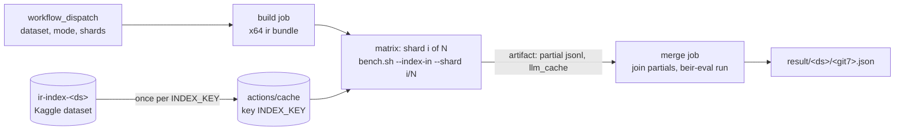

# Eval compute: fastest free path for bench.sh quality runs

Answer: shard the hybrid queries across a GitHub Actions matrix of public-repo x64 runners, keep
the index in the `ir-index-<ds>` Kaggle dataset (seeded into `actions/cache` once per `INDEX_KEY`),
and save partial results and `llm_cache` so no query is reranked twice. scifact hybrid: 21 h → 1.4 h.
Rules kept: off the owner's Mac, free tiers only, data as Kaggle datasets, GitHub Actions starts runs.
Checked 2026-11-13; "est." = not measured. GitHub public repos (docs.github.com runners reference,
Actions limits): free, 4 vCPU/16 GB on x64 and arm64, 20 concurrent jobs, 6 h per job, 10 GB cache.

## Ranked levers (wall time saved per unit of effort)

| # | Lever | Hybrid scifact wall time | Effort | Quality unchanged | Source |
|---|---|---|---|---|---|
| 1 | GitHub matrix, N shards | 21 h → about 1.4 h (N = 20) | M: `--shard i/N`, merge job, workflow matrix | yes | probe run 43344051901 |
| 2 | Save partials + `llm_cache` after queries | rerun: 21 h → about bm25+vector time; a 12 h stop resumes | S: `run.py`/`bench.sh` | yes, with a cache key guard | `beir-eval.py:370`, `hybrid.rs:888` |
| 3 | Quick runs on the first n queries | linear in n; paired check only | S: `--max-queries` exists | no claim on absolute nDCG | probe run 43344051901 |
| 4 | Several Kaggle CPU sessions | 21 h / k (k = concurrent session limit, unconfirmed) | M: one slug per shard in `ci.sh` | yes | shares sessions with task #14 |
| 5 | CPU knobs (threads, doc batching) | unknown, needs a measure | S to M (code) | yes; quantization: no | `scoring.rs:169-254` |
| 6 | Free GPU | none fits today | owner check of Kaggle web UI | yes | see Free GPU |

## Facts behind the numbers

- Kaggle CPU hybrid scifact: 167/300 queries in 11 h 49 min; queries finish in pairs (163 and 164 at
  11:36:39), so about half take the strong-signal shortcut and a reranked query costs about 6-7 min
  (run 43226621572 artifact, `bench.log`). Full run about 21 h.
- Wall time of a sharded run ≈ setup + Q₂ · t₂ / N, with Q₂ = queries that reach tier 2 and
  t₂ = seconds per reranked query. GitHub arm64 (Neoverse-N2, 4 vCPU) t₂ = 531 s median, 383-599 s
  (9 of 12 queries in 4500 s, shortcuts off, 500-doc scifact pool; probe run 43344051901). Embed:
  1.33 s/doc (500 docs in 666 s), equal to Kaggle (7036 s / 5183 docs = 1.36 s/doc).
- Queries: scifact 300, fiqa 648 (BEIR test), miracl-ko 213 (`download-ko-miracl.py`), miracl-zh dev
  (MIRACL, about 393, est.). Korean and Chinese rarely hit the BM25 shortcut, so take Q₂ ≈ all (est.).

| Dataset (pool) | Q₂ (est.) | Kaggle, 1 session (est.) | GitHub, N = 20 (est.) |
|---|---|---|---|
| scifact (full) | 150 | 21 h (measured) | about 1.4 h |
| fiqa (10k) | 648 | over 12 h: does not fit | about 5.3 h (40 shards, 2 waves) |
| miracl-ko (10k) | 213 | about 24 h | about 1.8 h |
| miracl-zh (10k) | 393 | about 44 h | about 3.1 h |

Kaggle = Q₂ × 400 s. GitHub = 15 min setup per wave (job start to first probe step, build included)
+ Q₂ × 531 s / 20. Keep shards under about 3 h: fiqa on 20 shards is 4.8 h per job, near the 6 h
limit at t₂ = 599 s. Shorter passages than scifact abstracts cost less (est.).

## Lever notes

1. **Sharding.** beir-eval resumes from `<output>.partial/<mode>.jsonl` (ranked list per query).
   Merge = join the shard partials into one file, then `beir-eval run`: nothing remains, metrics
   come from all queries. Only a `--shard i/N` filter is new. The index reaches each shard from
   `actions/cache` keyed by `INDEX_KEY` (seeded once from the Kaggle dataset; tens of MB), the
   `ir` bundle from the build job artifact. Embedding stays one job per `INDEX_KEY`.
2. **Reuse.** `llm_cache` key = GGUF file name + lowercased query + content hash. It lives in the
   collection DB, but `bench.sh` saves the index before queries, so it ships empty. Stale risk: the key
   misses the prompt template, `MAX_DOC_CHARS` and model bytes; guard it like `INDEX_KEY` (sha256
   of the GGUF + `scoring.rs` + `reranker.rs`). Hits cover every doc still in a query's top 100.
   No query-embedding cache exists (`vector.rs:19`); the expander is off by default.
3. **Subsampling.** Per-query nDCG@10 SD = 0.383 (bm25, full scifact, n = 300; run 43344051901),
   so an absolute ±0.005 interval needs n = (1.96·0.383/0.005)² ≈ 22,500 queries, far above every
   dataset. The ±0.005 tolerance is a same-query comparison with a reference. A quick run on the
   first n queries compares with the reference's scores on the same ids. Paired SD for a large
   change (vector − bm25, 500-doc pool) = 0.290, mean 0.070 (same run): that change shows at
   n ≈ (1.96·0.290/0.070)² ≈ 66 queries; δ = 0.005 needs about 12,900, and a full 300-query run
   resolves it only when the paired SD ≤ 0.044. Quick runs catch large regressions only. Full run:
   before a release, a default change or a published number.
4. **Kaggle sessions.** Same sharding, one kernel slug per shard; `ci.sh` waits on each. Uses the
   sessions task #14 needs.
5. **CPU knobs.** Threads = `available_parallelism()`, no env knob. The reranker decodes 1 + 100
   sequences one by one; batching docs into one decode keeps scores (float rounding aside).
   Changing the q8_0 GGUF, the window or `MAX_DOC_CHARS` changes measured quality: not a speed knob.
   arm64 vs x86: arm64 t₂ = 531 s against about 400 s on Kaggle's 4 vCPU Xeon (inferred from pairs),
   so arm64 reranks about 1.3× slower (est.); embed speed is equal. Run the matrix on ubuntu-24.04
   (x64): `eval-kaggle.yml` already builds that bundle. Measure x64 t₂ in the first matrix run.
6. **Free GPU.** Kaggle T4 (about 30 h/week, 12 h session) is the only free GPU a CI job can start,
   and API pushes get CPU (run 43120474122). Colab free, HF ZeroGPU (Gradio Spaces only, 5 min/day),
   SageMaker Studio Lab (closed to new users), Paperspace free (M4000): no headless start found.
   Lightning AI and Modal give monthly credits, partly tied to a card: not a free tier under the rules.
   Sources: docs.github.com runners reference and Actions limits; gpuperhour.com free GPU list (2026).

## Recommended plan

Next build task: add `beir-eval.py run --shard i/N`, save partials and `llm_cache` after queries
(with the cache key guard), and an `eval-matrix.yml` workflow. The workflow edit must land through the
owner (the wsx token has no `workflow` scope).

## Unknown

- Kaggle concurrent CPU session limit, and whether a scheduled web-UI notebook gets a GPU.
- Why API-pushed Kaggle kernels get no GPU (account check in the web UI).
- GitHub x64 runner speed per reranked query (only arm64 probed), and t₂ on fiqa and MIRACL passages.
- Speed gain of a thread knob or doc batching: needs a code change and a measure.
