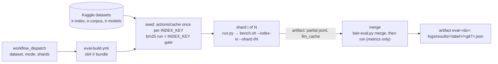

# Eval compute: the sharded GitHub matrix for bench.sh quality runs

Answer: shard the queries across a GitHub Actions matrix of public-repo x64 runners
(`.github/workflows/eval-matrix.yml`, steps in `scripts/eval-matrix.sh`). The index comes from the
`ir-index-<ds>` Kaggle dataset ([kaggle-eval.md](kaggle-eval.md)), and `llm_cache` is saved so no
query is reranked twice. scifact hybrid: 21 h on one Kaggle CPU session → about 0.9 h on 20 shards.
Rules kept: off the owner's Mac, free tiers only, data as Kaggle datasets, GitHub Actions starts runs.
GitHub public repos (docs.github.com runners reference, Actions limits, checked 2026-11-13): free,
4 vCPU/16 GB x64 and arm64, 20 concurrent jobs, 6 h per job, 10 GB cache. "est." = not measured.

## How to run

1. `ir-index-<ds>` must match this build: if seed reports a stale `INDEX_KEY`, run `eval-kaggle.yml dataset=<ds> mode=vector`.
2. `gh workflow run eval-matrix.yml -f dataset=<ds> -f mode=hybrid -f shards=20`.
3. A failed or timed-out shard: "Re-run failed jobs". Each shard saves its `llm_cache` to `actions/cache`
   even on failure and the rerun restores it; a new dispatch with the same `RERANK_KEY` restores the last merge.
   A "Re-run failed jobs" can fail to start: attempt 2 of run 44118100411 ended `startup_failure`
   with 0 jobs in 4 s, and after it `gh run rerun --job 134177104387` answers "cannot be rerun"
   (GitHub documents no cause; the branch had been force-pushed past the run's SHA). So mode=rerank
   does not rely on reruns: a new dispatch reuses each finished shard (`rr_saved`, below).
4. Shard+merge check after a change to sharding: `mode=bm25 shards=3` must equal `eval-kaggle.yml mode=bm25`
   on all 7 metrics (scifact nDCG@10 0.6912).
5. Reranker rows (research/reranker-eval.md): `mode=dump` once per index and code, then
   `mode=rerank -f configs="<names>"` per new reranker config.

## How it works

- **Sharding.** `beir-eval.py run --shard i/N` keeps sorted query id k when k % N = i-1; the result is
  `<git7>.shard-i-of-N.json`. `beir-eval.py merge` joins the partials (`<output>.partial/<mode>.jsonl`)
  and fails on a missing id; `beir-eval.py run` on the merged partial computes metrics without calling `ir`.
- **Reuse.** The `llm_cache` key (`src/search/hybrid.rs`) misses the prompt template, `MAX_DOC_CHARS` and
  model bytes, so rows move between runs only under `RERANK_KEY` (sha256 of the reranker GGUF + `scoring.rs`
  + `reranker.rs`, computed once by seed); `rerank_cache` drops rows stamped with another key.
- **Rerank shards** (mode=rerank). A finished shard saves its partials in `W/llm-cache/rr/<key>/i-of-N`
  (key: dump, configs with their models, ranking code); merge carries all of them into the merged
  `llm_cache` entry, and a new dispatch restores them and runs only shards without one.
  Proof: run 44164412028 dispatched again the configs of fiqa run 44142388088. All 20 shards logged
  "reusing the partials of an earlier run", ran no query and took 16-68 s each, against 57-82 min
  per shard in the first run. The merged rows are equal.
- **Cache egress.** The account has an undocumented `actions/cache` egress limit. Run 44118100411
  restored 134.2 GB (20 shards × 6.39 GB: models 6.28 GB with three listwise GGUFs, data 81 MB, dump
  27 MB, llm_cache 5 MB, plus seed); shard 18 (job 134177104387) hit "Egress is over the account
  limit" and fail-on-cache-miss ended it before any query. Since then a rerank run caches no model
  (`eval-models-none`): each shard downloads its pinned GGUFs from Hugging Face and checks the
  sha256 (`fetch_models`), so a run restores about 2.3 GB (20 × 113 MB + seed).
- **Proof** (run 43670392239, a one-time probe in the x64 Kaggle job): bm25 on 3 shards merged = unsharded
  on all 7 metrics (nDCG@10 0.6912); a rerun of hybrid shard 1/20 added 0 `llm_cache` rows (400 → 400),
  1187 s → 3 s.

## Timing model

Wall time ≈ setup + Q₂ · t₂ / N (Q₂ = queries that reach tier 2, t₂ = seconds per reranked query).

- x64 (ubuntu-24.04, 4 vCPU) t₂ = 296 s median, 240-352 s (4 reranked of 15 queries, full scifact, hybrid
  shard 1/20; run 43670392239). arm64 (Neoverse-N2) t₂ = 531 s, 383-599 s (run 43344051901): 1.8× slower.
  Embed: 1.33 s/doc on arm64, equal to Kaggle (7036 s / 5183 docs).
- Kaggle CPU scifact hybrid: 167/300 queries in 11 h 49 min, queries finish in pairs, so about half take the
  strong-signal shortcut and a reranked query costs about 400 s (run 43226621572). Full run about 21 h.
- Queries: scifact 300, fiqa 648, miracl-ko 213, miracl-zh 393. Korean and Chinese rarely hit the BM25
  shortcut, so Q₂ ≈ all (est.).

| Dataset (pool) | Q₂ (est.) | Kaggle, 1 CPU session | GitHub, N = 20 (est.) |
|---|---|---|---|
| scifact (full) | 150 | 21 h (est. from the stopped run) | about 0.9 h |
| fiqa (10k) | 648 | about 27 h: does not fit | about 2.9 h |
| miracl-ko (10k) | 213 | 10.4 h measured | about 1.1 h |
| miracl-zh (10k) | 393 | about 16 h: does not fit | about 1.9 h |

GitHub = 15 min setup (build included) + Q₂ × 296 s / 20. fiqa on 20 shards is about 3.2 h per job at
t₂ = 352 s, under the 6 h limit; use `shards=40` (2 waves of 20) only if its t₂ is above about 600 s.

## Measured Kaggle CPU runs (pooled, seed 42)

bm25 must equal a local run on the same pool (`logs/results/<ds>-s<N>-p42/`). Job = the GitHub job; bench.sh = sampling, prepare and queries.

| Run | Job | bench.sh | nDCG@10 Kaggle (local Mac) | Source |
|---|---|---|---|---|
| fiqa bm25, 10000 | 393 s | 227 s | 0.3788 (0.3788), all 7 metrics equal | run 43296099890 |
| miracl-ko bm25, 10000 | 273 s | 101 s | 0.8203 (0.8203), all 7 equal | run 43301175140 |
| miracl-zh bm25, 10000 | 409 s | 208 s | 0.7305 (0.7305); ndcg_100 0.7587 vs 0.7586 | run 43239977404 |
| miracl-ko bm25, 50000 | 426 s | 148 s | 0.7182 (0.7182), all 7 equal | run 43164214484 |
| miracl-zh bm25, 50000 | 601 s | 263 s | 0.6328 (0.6328), all 7 equal | run 43165259174 |
| miracl-ko hybrid, 50000 | 2 jobs | 40,129 s (11.1 h) | 0.9611 (no local model files) | runs 43165547171, 43227274582 |
| miracl-ko hybrid, 10000 | 2 jobs | 37,267 s (10.4 h) | 0.9737, 0 failed queries | runs 43342505595, 43555047447 |
| same, rerun on the saved index | 5 h 3 min | 18,032 s | 0.9737, all 7 equal; `index: key match` | run 43557726443 |

- miracl-ko 10000: prepare (10,082 chunks, ANN) 5,750 s, 213 queries 31,492 s (148 s per query). The pool
  shrinks the embed, not the queries: each tier-2 query reranks 100 documents.
- The rerun took 85 s per query (cause not measured: Kaggle saves the index before the queries, so its
  `llm_cache` is empty). A first Kaggle hybrid run outlasts the job: dispatch it again to collect it.

## Measured GitHub matrix runs (scifact, 20 shards, main 013aacd)

Baseline for search experiments. Earlier matrix runs on 3f01c10 (vector 0.7446, hybrid 0.7547) and the Kaggle 0.7706 and local 0.7717 vector references predate the daemon wait in `scripts/bench.sh`: cold shards answered 5-7 queries from BM25.

| Run | Wall | Shard job median (min-max) | nDCG@10 | Source |
|---|---|---|---|---|
| vector | 27 min (build 13 min; Seed rerun after a transient Kaggle 403) | 66.5 s (42-120 s) | 0.7774, 0 failed queries | run 43994765211 |
| hybrid | 46 min 26 s | 908 s (321-1706 s) | 0.7806, 0 failed queries (recall_10 0.8977) | run 43998554870 |

## Not built

- Quick runs on the first n queries (`--max-queries`): per-query nDCG@10 SD = 0.383 (bm25, scifact,
  run 43344051901), paired SD 0.290 for vector − bm25, so a change shows at n ≈ 66 only when it is large
  (0.070); δ = 0.005 needs about 12,900 queries. Quick runs catch large regressions only.
- Several Kaggle CPU sessions, one slug per shard: needs the concurrent session limit (unknown).
- CPU knobs: threads = `available_parallelism()`; the reranker decodes 1 + 100 sequences one by one, and
  batching docs keeps scores (float rounding aside). The GGUF, window and `MAX_DOC_CHARS` change quality.
- Free GPU: Kaggle T4 is the only one a CI job can start, and API pushes get CPU (run 43120474122). Colab
  free, HF ZeroGPU, SageMaker Studio Lab, Paperspace free: no headless start; Lightning AI and Modal tie
  credits to a card.
- Open: why API pushes get no GPU; t₂ on fiqa and MIRACL passages (only scifact measured).
