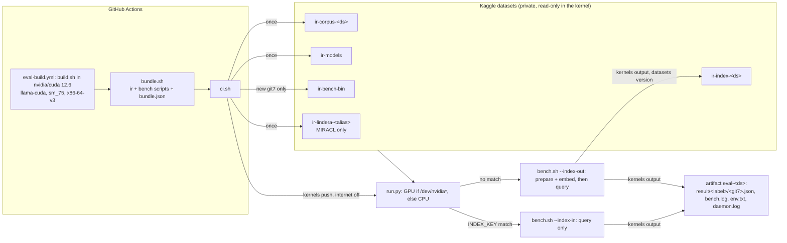

# Retrieval eval on Kaggle (GPU or CPU)

`scripts/bench.sh` quality runs (nDCG, recall) on Kaggle's free tier, started from GitHub Actions
(`.github/workflows/eval-kaggle.yml`, `workflow_dispatch`). `run.py` uses the T4 when the session has
one and the CPU otherwise. Kaggle speed numbers do not compare with a local GPU: preship floors do not
apply. Hybrid on CPU in hours: the sharded GitHub matrix, [eval-compute.md](eval-compute.md).



## Setup (once)

1. Kaggle account with phone verification (GPU needs it).
2. Repo secrets: `KAGGLE_USERNAME`, plus `KAGGLE_API_TOKEN` (new token) or `KAGGLE_KEY` (legacy key).
   The workflow reads them as env vars only (`lib.sh` `kaggle_auth`); nothing writes a token file.
3. Run the workflow. The first run seeds the corpus and model datasets, then builds the index on Kaggle.

## How to run

```bash
gh workflow run eval-kaggle.yml -f dataset=scifact -f mode=vector       # build, push, wait, artifact eval-scifact
gh workflow run eval-kaggle.yml -f fetch=ir-bench-scifact/8            # only download that session's output: artifact kaggle-output
gh workflow run eval-kaggle.yml --ref <branch> -f dataset=scifact      # a branch's scripts and workflow file
```

The kernel slug is `ir-bench-<dataset>`; the version is in the job log (`Kernel version N successfully pushed`).
A workflow file that is not on `main` yet cannot be dispatched (GitHub runs `workflow_dispatch` only for files on the default branch).

## Rules

| What | Rule |
|---|---|
| Datasets | One table: `scripts/kaggle/lib.sh` `dataset_spec` (pool size, preprocessor alias, dictionary, bench.sh label), used by `ci.sh` and `eval-matrix.sh`. `run.py` builds the only `bench.sh` command line from its `IRK_*` env |
| Index reuse | `run.py` compares `INDEX_KEY`: `bundle.json` `index_key_src` (embedding file name, sha256 of `chunker.rs`, `embed.rs`, `embedding.rs`, `ann.rs`, `schema.rs`, `preprocess.rs`) + dataset label + sha256 of the embedding GGUF; for MIRACL also the preprocessor command from `config.yml`, the lindera sha256 and a sha256 over the dictionary files. Any change rebuilds |
| MIRACL corpus | `scripts/download-miracl.py` (stdlib, pinned HF revisions; `datasets` 4 no longer runs the MIRACL loader scripts) seeds the full dev split once: ko 1,486,752 passages (670 MB), zh 4,934,368 (1.8 GB) |
| Pool | fiqa, miracl-ko and miracl-zh run on a 10000-doc pool (`bench.sh --size 10000 --seed 42`: all qrel-linked docs plus a seeded random rest), results under `<ds>-s10000-p42`. 10000 is the stable floor of the pool variance study (CLAUDE.md); CPU embedding of a 50000-doc MIRACL pool outlasted a GitHub job. scifact and nfcorpus run on the full corpus. **Scores compare only on the same pool**: compare with `scripts/bench.sh <ds> --size 10000 --seed 42`, not with full-corpus or 50000-doc numbers |
| Preprocessor | `ir-lindera-<alias>` holds the Linux x86-64 lindera binary and the dictionary (ko-dic or jieba) flat, plus a `PREPROCESSOR` marker (alias, lindera tag, dictionary). `ci.sh` takes the tag from `LINDERA_VERSION` in `src/main.rs` and checks each release zip against `LINDERA_SHA256`: a version bump fails until it is pinned. One dataset per alias: both dictionaries have files named `dict.da` etc. |
| Offline install | `run.py` copies the files to `HOME/.config/ir/preprocessors/lindera-<tag>/lindera` and `.../<dict>/`, then runs `ir preprocessor install <alias>`: it finds them and skips the download, so `config.yml` gets ir's own `$IR_DIR` command (`bench-env.sh` copies it). `run.py` then runs the CLAUDE.md sentinel probe and fails unless the output equals the macOS lindera v3.0.5 output (`PROBES`). ko gives 2 lines for 3: the stop-tag filter drops `.`, the 0-output case IRSENTINEL covers |
| bm25 runs | Never save an index (bm25 prepare skips embedding); pushed with `enable_gpu` false |
| Collection name | `eval-<label>` with `--index-in`/`--index-out`, `eval-<label>-<git7>` otherwise |
| Read-only inputs | Index files are copied to `/tmp/irk` (search opens the DB read-write); the corpus is symlinked. The kernel runs with `enable_internet: false`; models come from `ir-models` by path |
| CUDA build env | `NK_TARGET_SAPPHIREAMX=0` (numkong AMX kernels need GCC 12+, run 43019698386); `CMAKE_DISABLE_FIND_PACKAGE_NCCL=TRUE` (llama-cpp-sys-2 does not link the image's NCCL, run 43028557699). A CMAKE_* change does not rerun llama-cpp-sys-2's build.rs: change the rust-cache key |
| CLI exit codes | `kaggle` 2.2.5 exits 0 after "Dataset creation error", "Dataset version creation error", "Kernel push error" and "not valid dataset sources" (`*_cli` in `kaggle_api_extended.py`). `ci.sh` `kcheck` fails on that text |
| Dataset versions | `ci.sh` waits for `status=ready` and `current_version_number` above the old one; a kernel could mount the old files otherwise. `run.py` also checks `IRK_GIT7` against `bundle.json` |
| Kernel status | `ci.sh` pins the pushed version (`kernels status <owner>/<slug>/<N>`), else a rerun can read the previous run's `complete` |
| No GPU from the API | Kernels pushed by `kaggle kernels push` got a CPU session (4 vCPU Xeon 2.2 GHz, no `/dev/nvidia*`, no driver libraries), although the server stored `enable_gpu` true and `machine_shape` NvidiaTeslaT4 and the weekly quota was unused (run 43120474122). Cause not found; check the account in the Kaggle web UI. `ci.sh` prints `kaggle quota` and the stored settings |
| CPU fallback | `run.py` runs the same CUDA build on the CPU backend (`IR_FORCE_CPU_BACKEND=1`, `IR_GPU_LAYERS=0`). `ir` has `libcuda.so.1` in NEEDED and imports 11 `cu*` driver functions, so `run.py` builds a stub that defines them; ggml-cuda then finds no device (`[irk] backend: CPU`, run 43147559287) |
| x86-64-v3 build | `build.sh` adds `-C target-cpu=x86-64-v3`: llama-cpp-sys-2 turns `GGML_NATIVE` off and takes AVX flags only from the Rust target features, so ggml-cpu would be SSE2-only. `run.py` stops when the CPU lacks avx2/fma/f16c/bmi2; `env.txt` counts `vfmadd` in `ir` (7545) |
| CPU timeouts | On CPU `run.py` sets `IR_DAEMON_REPLY_TIMEOUT=1800` (else a `-q` search silently falls back to BM25 after 120 s) and `IR_BENCH_QUERY_TIMEOUT=1900`. `beir-eval.py` reports `failed_queries` and `timing.total_s` per mode |
| Session outlasts the job | The job waits `IRK_WAIT_MIN` (320) min inside 350; a CPU session can run 12 h. Dispatch the same ref, dataset and mode again: `ci.sh` compares the first line of the latest session (dataset, mode, git7) and attaches while it runs, or collects its output when complete (no push, no upload; run 43226621572). To rerun the same commit, push a new commit. Another header still running fails the job. A session Kaggle stopped (`cancel_acknowledged`, 12 h): input `fetch` |
| Kaggle image | Ubuntu 24.04, glibc 2.39, Python 3.13, `gcc` present; datasets mount at `/kaggle/input/datasets/<owner>/<slug>` (run 43115533477). `bundle.sh` ships the build host's `libgomp.so.*` flat (Kaggle datasets skip directories); `run.py` puts it on `LD_LIBRARY_PATH` |
| Auth | `kaggle` 2.2.5 tries `KAGGLE_API_TOKEN` first, then `KAGGLE_USERNAME` + `KAGGLE_KEY` (`kaggle_api_extended.py` `authenticate`) |

## Local dry run (no Kaggle, no model run on the Mac: bm25 only)

```bash
scripts/kaggle/bundle.sh target/release/ir <input>/bin
# <input>/corpus: corpus.jsonl queries.jsonl test.tsv DATASET; <input>/models: the three GGUF files
IRK_DATASET=scifact IRK_MODE=bm25 IRK_INPUT=<input> IRK_WORKING=<work> IRK_ROOT=<short-dir> python3 scripts/kaggle/run.py
```

## CPU timings (scifact, 4 vCPU Xeon 2.2 GHz, 300 queries)

| Step | Wall time | nDCG@10 (local Mac) | Source |
|---|---|---|---|
| prepare + embed (5858 chunks) | 7036 s (1 h 57 min) | n/a | run 43147559287 |
| reuse the index dataset | under 1 min (`index: key match`, no `preparing collection`) | n/a | run 43168270510 (kernel 8) |
| bm25 | 72.8 s | 0.6912 (0.6912) | kernel 8 |
| vector | 73.4 s | 0.7706 (0.7717) | kernel 8; also run 43147559287 |
| hybrid | 167/300 after 11 h 49 min, stopped at 12 h | none | kernel 8, collected by run 43226621572 |

Full fiqa does not fit a session either (embed alone about 13.5 h), so it runs on the pool. Pooled and
MIRACL runs: [eval-compute.md](eval-compute.md), Measured Kaggle CPU runs.

## Limits (sources checked 2026-11)

- GPU quota about 30 h/week, 12 h per session; T4 x2 default, P100 retired (`kaggle` 2.2.5 `--accelerator` help).
- Private dataset quota 200 GB. Output (`/kaggle/working`) about 20 GB.
