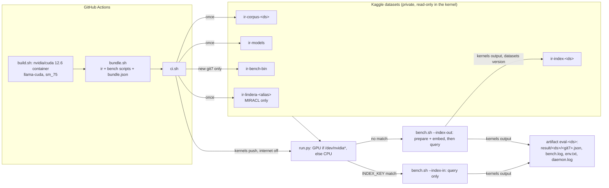

# Retrieval eval on Kaggle (GPU or CPU)

`scripts/bench.sh` quality runs (nDCG, recall) on Kaggle's free tier, started from
GitHub Actions (`.github/workflows/eval-kaggle.yml`, `workflow_dispatch`). `run.py` uses the T4
when the session has one and the CPU otherwise. Speed numbers from Kaggle are not comparable
with a local GPU: preship floors do not apply.



## Setup (once)

1. Kaggle account with phone verification (GPU needs it).
2. Repo secrets: `KAGGLE_USERNAME`, plus `KAGGLE_API_TOKEN` (new token) or `KAGGLE_KEY` (legacy key).
   The workflow reads them as env vars only; nothing writes a token file.
3. Run the workflow. The first run seeds the corpus and model datasets, then builds the index on Kaggle.

## Rules

| What | Rule |
|---|---|
| Index reuse | `run.py` compares `INDEX_KEY`: `bundle.json` `index_key_src` (embedding file name, sha256 of `chunker.rs`, `embed.rs`, `embedding.rs`, `ann.rs`, `schema.rs`) + dataset label + sha256 of the embedding GGUF; for MIRACL also the preprocessor command from `config.yml`, the lindera sha256 and a sha256 over the dictionary files. Any change rebuilds. |
| MIRACL corpus | `scripts/download-miracl.py` (stdlib, pinned HF revisions; `datasets` 4 no longer runs the MIRACL loader scripts) seeds the full dev split once: ko 1,486,752 passages (670 MB), zh 4,934,368 (1.8 GB). The kernel samples it (next row) |
| Pool | fiqa, miracl-ko and miracl-zh run on a 10000-doc pool: `ci.sh` passes `bench.sh --size 10000 --seed 42`, so every run samples the same pool (`beir-eval.py sample`: all qrel-linked docs plus a seeded random rest). 10000 is the stable floor of the pool variance study (CLAUDE.md); CPU embedding of a 50000-doc MIRACL pool outlasted a GitHub job. scifact and nfcorpus run on the full corpus. Results are under `<ds>-s10000-p42`. **Scores compare only on the same pool**: compare with a local run of the same command (`scripts/bench.sh <ds> --size 10000 --seed 42`), not with full-corpus or 50000-doc numbers |
| Preprocessor | `ir-lindera-<alias>` holds the Linux x86-64 lindera binary and the dictionary (ko-dic or jieba) flat, plus a `PREPROCESSOR` marker (alias, lindera tag, dictionary). `ci.sh` takes the tag from `LINDERA_VERSION` in `src/main.rs` and checks each release zip against a pinned sha256 (`LINDERA_SHA256`): a version bump fails until it is pinned. One dataset per alias: both dictionaries have files named `dict.da` etc. |
| Offline install | `run.py` copies the files to `HOME/.config/ir/preprocessors/lindera-<tag>/lindera` and `.../<dict>/`, then runs `ir preprocessor install <alias>`: it finds them and skips the download, so `config.yml` gets ir's own `$IR_DIR` command. `bench-env.sh` copies that `config.yml` and links `preprocessors/`. `run.py` then runs the CLAUDE.md sentinel probe on the command and fails unless the output equals the macOS lindera v3.0.5 output (`PROBES`). ko gives 2 lines for 3: the stop-tag filter drops `.`, the 0-output case the IRSENTINEL protocol covers |
| bm25 runs | Never save an index (bm25 prepare skips embedding); pushed with `enable_gpu` false |
| Collection name | `eval-<ds>` with `--index-in`/`--index-out`, `eval-<ds>-<git7>` otherwise |
| Read-only inputs | Index files are copied to `/tmp/irk` (search opens the DB read-write); the corpus is symlinked |
| No download | Kernel runs with `enable_internet: false`; models come from `ir-models` by path |
| CUDA build env | `NK_TARGET_SAPPHIREAMX=0` (numkong AMX kernels need GCC 12+, run 43019698386); `CMAKE_DISABLE_FIND_PACKAGE_NCCL=TRUE` (ggml finds the image's NCCL but llama-cpp-sys-2 does not link it, run 43028557699). A CMAKE_* change does not rerun llama-cpp-sys-2's build.rs: change the rust-cache key |
| CLI exit codes | `kaggle` 2.2.5 exits 0 after "Dataset creation error", "Dataset version creation error", "Kernel push error" and "not valid dataset sources" (`*_cli` in `kaggle_api_extended.py`). `ci.sh` `kcheck` fails on that text |
| Dataset versions | `ci.sh` waits for `status=ready` and `current_version_number` above the old one (`datasets status --format json`); a kernel could mount the old files otherwise. `run.py` also checks `IRK_GIT7` against `bundle.json` |
| Kernel status | `ci.sh` pins the pushed version (`kernels status <owner>/<slug>/<N>`), else a rerun can read the previous run's `complete` |
| No GPU from the API | Kernels pushed by `kaggle kernels push` got a CPU session (4 vCPU Xeon 2.2 GHz, no `/dev/nvidia*`, no driver libraries), although the server stored `enable_gpu` true and `machine_shape` NvidiaTeslaT4 and the weekly quota was unused (probe run 43120474122). Cause not found; check the account in the Kaggle web UI. `ci.sh` prints `kaggle quota` and the stored settings |
| CPU fallback | No `/dev/nvidia*` and no `nvidia-smi -L`: `run.py` runs the same CUDA build on the CPU backend (`IR_FORCE_CPU_BACKEND=1`, `IR_GPU_LAYERS=0`). `ir` has `libcuda.so.1` in NEEDED and imports 11 `cu*` driver functions, so `run.py` builds a stub that defines them; ggml-cuda then finds no device. The log says `[irk] backend: CPU` (run 43147559287) |
| x86-64-v3 build | `build.sh` adds `-C target-cpu=x86-64-v3`: llama-cpp-sys-2 turns `GGML_NATIVE` off and takes AVX flags only from the Rust target features, so ggml-cpu would be SSE2-only. `run.py` stops when the CPU lacks avx2/fma/f16c/bmi2; `env.txt` counts `vfmadd` in `ir` (7545) |
| CPU timeouts | A tier-2 query on 4 vCPU can take minutes. On CPU `run.py` sets `IR_DAEMON_REPLY_TIMEOUT=1800` (else a `-q` search silently falls back to BM25 after 120 s) and `IR_BENCH_QUERY_TIMEOUT=1900`. `beir-eval.py` reports `failed_queries` and `timing.total_s` per mode |
| Session outlasts the job | The Kaggle job waits `IRK_WAIT_MIN` (320) min inside a 350 min job; a CPU session can run 12 h. Dispatch the same ref, dataset and mode again: `ci.sh` compares the first line of the latest session (dataset, mode, git7) and attaches while it runs, or collects its output when it is complete (no new push and no dataset upload; run 43226621572). To run the same commit again, push a new commit. Another header still running fails the job. A session that Kaggle stopped (`cancel_acknowledged`, 12 h) or any other session: input `fetch` |
| Kaggle image | Ubuntu 24.04, glibc 2.39, Python 3.13, `gcc` present; datasets mount at `/kaggle/input/datasets/<owner>/<slug>` (run 43115533477). The build container (Ubuntu 22.04, glibc 2.34 symbols) runs there |
| libgomp | `bundle.sh` ships the build host's `libgomp.so.*` flat in the bundle (Kaggle datasets skip directories); `run.py` puts it on `LD_LIBRARY_PATH` |
| Auth | `kaggle` 2.2.5 tries `KAGGLE_API_TOKEN` first, then `KAGGLE_USERNAME` + `KAGGLE_KEY` (`kaggle_api_extended.py` `authenticate`) |

## How to run

```bash
gh workflow run eval-kaggle.yml -f dataset=scifact -f mode=vector       # build, push, wait, artifact eval-scifact
gh workflow run eval-kaggle.yml -f fetch=ir-bench-scifact/8            # only download that session's output: artifact kaggle-output
```

The kernel slug is `ir-bench-<dataset>`; the version is in the job log (`Kernel version N successfully pushed`).

## CPU timings (scifact, 4 vCPU Xeon 2.2 GHz, 300 queries)

| Step | Wall time | nDCG@10 (local Mac) | Source |
|---|---|---|---|
| prepare + embed (5858 chunks) | 7036 s (1 h 57 min) | n/a | run 43147559287 |
| reuse the index dataset | under 1 min (`index: key match`, no `preparing collection`) | n/a | run 43168270510 (kernel 8) |
| bm25 | 72.8 s | 0.6912 (0.6912) | kernel 8 |
| vector | 73.4 s | 0.7706 (0.7717) | kernel 8; also run 43147559287 |
| hybrid | about 255 s per query; 167/300 after 11 h 49 min, stopped at 12 h | none | kernel 8, collected by run 43226621572 |

- Hybrid does not fit a CPU session: scifact needs about 21 h. Each tier-2 query reranks 100 documents with the 0.6B model.
- Full fiqa does not fit either: its embed alone is about 6.9× scifact (by words), about 13.5 h. The Kaggle path runs fiqa on the 10000-doc pool (next section).
- On CPU, run `bm25` and `vector`. Hybrid needs the GPU, or the queries split across sessions (not built).

## CPU timings (pooled datasets, seed 42)

bm25 scores must equal a local run on the same pool (`logs/results/<ds>-s<N>-p42/`). Job is the GitHub Kaggle job; bench.sh is the kernel's sampling, prepare and queries.

| Run | Job | bench.sh | nDCG@10 Kaggle (local Mac) | Source |
|---|---|---|---|---|
| fiqa bm25, 10000 | 393 s | 227 s | 0.3788 (0.3788), all 7 metrics equal | run 43296099890 |
| miracl-ko bm25, 10000 | 273 s | 101 s | 0.8203 (0.8203), all 7 equal | run 43301175140 |
| miracl-zh bm25, 10000 | 409 s | 208 s | 0.7305 (0.7305); ndcg_100 0.7587 vs 0.7586 | run 43239977404 |
| miracl-ko bm25, 50000 | 426 s | 148 s | 0.7182 (0.7182), all 7 equal | run 43164214484 |
| miracl-zh bm25, 50000 | 601 s | 263 s | 0.6328 (0.6328), all 7 equal | run 43165259174 |
| miracl-ko hybrid, 50000 | 2 jobs | 40,129 s (11.1 h) | 0.9611 (no local model files) | runs 43165547171, 43227274582 |

- miracl-ko hybrid 50000: embedding 50,323 chunks 18,412 s (2.7 chunks/s), ANN 325 s, 213 queries 21,321 s (100 s per query).
- The pool shrinks the embed (10000 docs: about 1 h at 2.7 chunks/s), not the queries. Each tier-2 query reranks 100 documents.
  On CPU, hybrid fits one 12 h session only for miracl-ko (213 queries, about 7 h); miracl-zh (393, about 12 h) and fiqa (648, about 18 h) do not.

## Trying a change without the owner

The build job runs `scripts/kaggle/build.sh` and the Kaggle job runs `ci.sh` and `run.py`.
The `gh` token in wsx has no `workflow` scope: it cannot push `.github/workflows/`. A branch
off `main` that changes `scripts/` and `research/` only can be pushed, and runs with
`gh workflow run eval-kaggle.yml --ref <branch> -f dataset=scifact`. A workflow edit runs only after it lands on `main`,
and so does a new `dataset` option: to try a dataset that the branch's workflow does not list,
add a throwaway commit that maps a listed input to it in `ci.sh`, and drop that commit before merge.

## Local dry run (no Kaggle)

```bash
scripts/kaggle/bundle.sh target/release/ir <input>/bin
# <input>/corpus: corpus.jsonl queries.jsonl test.tsv DATASET; <input>/models: the two GGUF files
IRK_DATASET=scifact IRK_INPUT=<input> IRK_WORKING=<work> IRK_ROOT=<short-dir> python3 scripts/kaggle/run.py
```

Move `<work>/index` under `<input>` and run again: the log shows `index: key match` and no `preparing collection`.

## Limits (sources checked 2026-11)

- GPU quota about 30 h/week; T4 x2 default, P100 retired (`kaggle` 2.2.5 `--accelerator` help).
- Private dataset quota 200 GB. Output (`/kaggle/working`) about 20 GB.
- GitHub job limit 6 h; `IRK_WAIT_MIN` (default 320) bounds the poll.
