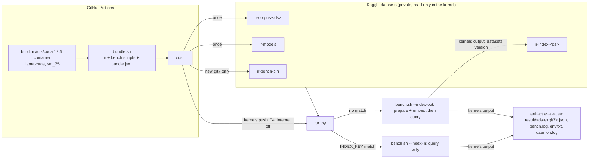

# Retrieval eval on a Kaggle GPU

`scripts/bench.sh` quality runs (nDCG, recall) on Kaggle's free T4, started from
GitHub Actions (`.github/workflows/eval-kaggle.yml`, `workflow_dispatch`). Speed
numbers from Kaggle are not comparable with a local GPU: preship floors do not apply.



## Setup (once)

1. Kaggle account with phone verification (GPU needs it).
2. Repo secrets: `KAGGLE_USERNAME`, plus `KAGGLE_API_TOKEN` (new token) or `KAGGLE_KEY` (legacy key).
   The workflow reads them as env vars only; nothing writes a token file.
3. Run the workflow. The first run seeds the corpus and model datasets, then builds the index on Kaggle.

## Rules

| What | Rule |
|---|---|
| Index reuse | `run.py` compares `INDEX_KEY`: `bundle.json` `index_key_src` (embedding file name, sha256 of `chunker.rs`, `embed.rs`, `embedding.rs`, `ann.rs`, `schema.rs`) + dataset + sha256 of the embedding GGUF. Any change rebuilds. |
| bm25 runs | Never save an index (bm25 prepare skips embedding); the kernel runs without a GPU |
| Collection name | `eval-<ds>` with `--index-in`/`--index-out`, `eval-<ds>-<git7>` otherwise |
| Read-only inputs | Index files are copied to `/tmp/irk` (search opens the DB read-write); the corpus is symlinked |
| No download | Kernel runs with `enable_internet: false`; models come from `ir-models` by path |
| CUDA build env | `NK_TARGET_SAPPHIREAMX=0` (numkong AMX kernels need GCC 12+, run 43019698386); `CMAKE_DISABLE_FIND_PACKAGE_NCCL=TRUE` (ggml finds the image's NCCL but llama-cpp-sys-2 does not link it, run 43028557699). A CMAKE_* change does not rerun llama-cpp-sys-2's build.rs: change the rust-cache key |
| Auth | `kaggle` 2.2.5 tries `KAGGLE_API_TOKEN` first, then `KAGGLE_USERNAME` + `KAGGLE_KEY` (`kaggle_api_extended.py` `authenticate`) |

## Local dry run (no Kaggle)

```bash
scripts/kaggle/bundle.sh target/release/ir <input>/bin
# <input>/corpus: corpus.jsonl queries.jsonl test.tsv DATASET; <input>/models: the two GGUF files
IRK_DATASET=scifact IRK_INPUT=<input> IRK_WORKING=<work> IRK_ROOT=<short-dir> python3 scripts/kaggle/run.py
```

Move `<work>/index` under `<input>` and run again: the log shows `index: key match` and no `preparing collection`.

## Not yet

- MIRACL ko/zh: the kernel needs a Linux lindera preprocessor (`config.yml` aliases under
  `HOME/.config/ir`), and its version must go into `INDEX_KEY`.

## Limits (sources checked 2026-11)

- GPU quota about 30 h/week; T4 x2 default, P100 retired (`kaggle` 2.2.5 `--accelerator` help).
- Private dataset quota 200 GB. Output (`/kaggle/working`) about 20 GB.
- GitHub job limit 6 h; `IRK_WAIT_MIN` (default 320) bounds the poll.
