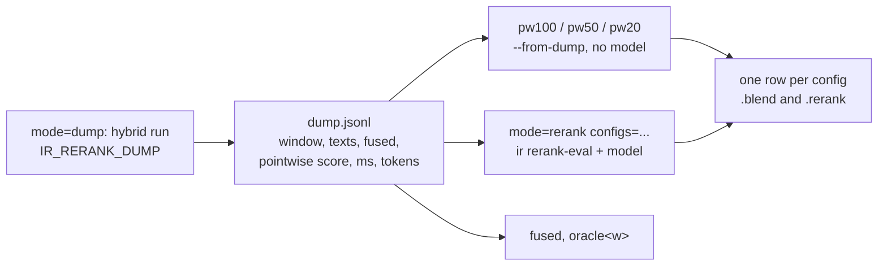

# Tier-2 reranker evaluation

Measures a reranker apart from retrieval: each query's tier-2 window is frozen once from a real
hybrid run, and every reranker config ranks the same windows. Runs go on GitHub x64 runners
(`eval-matrix.yml`, research/eval-compute.md).

## Method



1. `mode=dump` runs `bench.sh --mode hybrid` with `IR_RERANK_DUMP`. Each tier-2 query appends one
   line from `hybrid::rerank`: the window (path, text, fused score, pointwise score, ms, tokens) and the
   tail. The llm_cache is not read, so every cost is measured. A strong-signal shortcut appends a gate
   line (`bm25-strong`, `fused-strong`).
2. `beir-eval.py rerank` refuses the run if a query has no line: a fallback answered it (cold daemon,
   tier-2 timeout, failed query). It also refuses the run if the dump's own scores do not give the
   run's ranking.
3. Per config: `<name>.blend` is ir's final order (0.4·fused + 0.6·score, keep-window).
   `<name>.rerank` is the rerank-score order. `fused` is the window without reranking.
   `oracle<w>` is the best order of the first w docs, the ceiling of that window.
4. Gated queries keep the dump run's ranking in every row. `ndcg_10_t2` and `recall_10_t2` cover
   only the tier-2 queries, and `t2_mean_ms` / `t2_mean_tokens` give the cost per reranked query.

The configs are in `scripts/rerank-configs.json`. A listwise config sets `IR_LISTWISE_MODEL`
(a file in `models`, pinned by HF revision and sha256) and the `IR_LISTWISE_*` knobs. The seed
job caches only the models of the run's `configs` (all of them pass the 10 GB actions cache
limit), so rank one or two listwise models per run. `research_only` models (d1-3B, LFM Open
License v1.0) give benchmark rows only: ir never defaults to or downloads them.

## How to run

```bash
gh workflow run eval-matrix.yml --ref <branch> -f dataset=scifact -f mode=dump -f shards=20
gh workflow run eval-matrix.yml --ref <branch> -f dataset=scifact -f mode=rerank -f shards=20 \
  -f configs=lw-qwen3-0.6b-n20-t160
```

`mode=rerank` restores the dump of the same `DUMP_KEY`: the index, the reranker and the
retrieval code. After a change to any of them, run `mode=dump` again.

Local replay of one config over a dump:

```bash
IR_LISTWISE_MODEL=<gguf> ir rerank-eval --input dump.jsonl --output out.jsonl --window 20
```

## Listwise scorer (`src/llm/listwise.rs`)

N passages, labeled A..Z, go in one prompt. The scores come from the label-token logits at the
answer position (FIRST, arXiv 2406.15657). A window longer than N slides from the tail
(RankGPT). The score is 1 - rank/M. Pointwise stays the default. The prompt follows the GGUF's
`<arch>.decision.type` (research/decision-models.md):

| Type | Models | Prompt | Label logit |
|---|---|---|---|
| none | instruct (Qwen3) | the GGUF's chat template, `[A] passage` | `A` |
| `vllm-d3` | d3-lite, d3-nano | d3_format.py: system prompt, `State:` query, `A: passage` | `A` |
| `lfm2-d1` | d1-3B | prompt.py: no system, `QUESTION:`, `A passage` | max of `A`, ` A` |

d3's full-attention layers are non-causal (GGUF `attention.causal = false`), and libllama at
the llama-cpp-2 0.1.145 commit applies that key itself. So every prompt decodes in one batch
(`n_ubatch` = context): with `n_ubatch` 64, d3-lite hits llama.cpp's assert "non-causal
attention requires n_ubatch >= n_tokens", and Qwen3 does not. Not in that commit: llama.cpp
#28068 (Gated DeltaNet normalization), so qwen35 scores can differ slightly from the reference.

Observed in development (Qwen3-0.6B Q8, Metal): the model favors label A strongly. With two
passages it picks A in both orders (logit 34.5 vs 32.8), and `IR_LISTWISE_SHUFFLES=2` fixes
that case. One 5-passage prompt takes about 80-200 ms.

## Results

Proof gates for a dump run: its hybrid row equals the trusted hybrid run ±0.001. `pw100.blend`
equals the hybrid row. `oracle100` is at least every other row. Stop a listwise model at the first
dataset where it loses to `pw20` on both nDCG@10 and ms/query.

### scifact

Dump run 43999825138 (f38596b); listwise runs 44016959846 (d3, 62afb6f) and 44024239967 (d1-3B, 62afb6f), 44036692153 (Qwen3 control, 4c342f8). 300 queries, 183 reach
tier 2, no failed query. ms and tokens are per tier-2 query on one GitHub x64 runner.

| Row | nDCG@10 | R@10 | nDCG@10 t2 | ms / t2 query | tokens / t2 query |
|---|---|---|---|---|---|
| fused | 0.7827 | 0.8949 | 0.6664 | 0 | 0 |
| hybrid (dump run) | 0.7806 | 0.8977 | | | |
| pw100.blend | 0.7806 | 0.8977 | 0.6629 | 242540 | 36385 |
| pw50.blend | 0.7761 | 0.8943 | 0.6555 | 122552 | 18283 |
| pw20.blend | 0.7773 | 0.8932 | 0.6576 | 49996 | 7329 |
| lw-qwen3-0.6b-n20-t160.blend | 0.7645 | 0.8645 | 0.6365 | 34016 | 3294 |
| lw-d3-lite-n20-t160.blend | 0.7370 | 0.8482 | 0.5915 | 32321 | 3316 |
| lw-d3-nano-n20-t160.blend | 0.7398 | 0.8432 | 0.5960 | 67389 | 3316 |
| lw-d1-3b-n20-t160.blend | 0.7653 | 0.8806 | 0.6379 | 104248 | 3247 |
| oracle20 / 50 / 100 | 0.8962 / 0.9249 / 0.9649 | 0.9056 / 0.9350 / 0.9750 | 0.8524 / 0.8995 / 0.9651 | | |

- No reranker beats `fused`: tier 2 lowers scifact nDCG@10 in every config.
- The `.rerank` order (score only) is below `.blend` in every config: pw20 0.7723, d3-lite 0.7261,
  d3-nano 0.7308, d1-3B 0.7555, Qwen3 0.7624.
- The Qwen3-0.6B control (generic instruct, same listwise prompt path) ties d1-3B on nDCG@10
  (0.7645 vs 0.7653) in a third of the time (34 s vs 104 s) and beats both d3 models. The
  listwise method works; the d3 loss is the d3 judge.
- d1-3B is the best decision model (0.7653, 0.012 below pw20), but it takes 104 s per tier-2 query.
  d3-lite is the fastest (32 s, 35% below pw20) and loses 0.040.
- The stop rule would stop d3-nano and d1-3B here. Scifact alone does not decide, because pointwise
  also loses to fused on it. miracl-ko runs the pw rows and d1-3B, the best decision model (its card
  names Korean and lists reranking as an intended use).

The d3 readout was checked before the d3 rows were accepted:

1. Position bias: none. In the 183 tier-2 windows, d3-lite picks label A for 38% of queries,
   B 11%, C 8%, and no later label above 5%; T gets 1%. The relevant docs sit at A for 50% of
   queries (92 of 190 relevant docs in the windows are at A). So d3 picks A less often than the
   fused order would. Its non-A picks are relevant in 21 of 113 queries (d3-nano: 14 of 96).
2. Label readout: correct. A replay of 10 tier-2 queries (`ir rerank-eval`, Metal) read labels
   A..T as single tokens 32..51, at the last prompt token after `<think>\n\n</think>\n\n`. This
   matches d3_format.py (`d3-code-readout-v1`: `A: text` options, bare code tokens 32..57, readout
   at the last position). The argmax over the whole vocabulary was the chosen label in 10 of 10,
   and the top pick equals the CI x64 run's in 10 of 10.
3. `IR_LISTWISE_SHUFFLES=2` was not run: 1 and 2 show no bias. The d3 cards present d3 for routing
   and classification decisions, not for ranking. Its rerank order is below fused because the judge
   is weak on scifact, not because of the readout.

### miracl-ko (10000-doc pool)

Dump run 44060568465 and listwise run 44070074345 (both 3b1d6c5). 213 queries, 136 reach tier 2,
no failed query.

| Row | nDCG@10 | R@10 | nDCG@10 t2 | ms / t2 query | tokens / t2 query |
|---|---|---|---|---|---|
| fused | 0.9539 | 0.9805 | 0.9432 | 0 | 0 |
| hybrid (dump run) | 0.9737 | 0.9890 | | | |
| pw100.blend | 0.9737 | 0.9890 | 0.9742 | 117279 | 17542 |
| pw50.blend | 0.9731 | 0.9881 | 0.9732 | 61089 | 8975 |
| pw20.blend | 0.9680 | 0.9826 | 0.9652 | 27163 | 3797 |
| lw-qwen3-0.6b-n20-t160.blend | 0.9138 | 0.9274 | 0.8804 | 25584 | 2641 |
| lw-d3-lite-n20-t160.blend | 0.9315 | 0.9598 | 0.9081 | 23104 | 2393 |
| lw-d1-3b-n20-t160.blend | 0.9487 | 0.9795 | 0.9350 | 80225 | 2406 |
| oracle20 / 50 / 100 | 0.9838 / 0.9896 / 0.9902 | 0.9844 / 0.9908 / 0.9917 | 0.9899 / 0.9990 / 1.0 | | |

- Pointwise beats fused here (+0.020 at window 100, +0.014 at window 20). Every listwise row loses
  to fused. `.rerank` rows: d1-3B 0.9445, d3-lite 0.9157, Qwen3 0.8956.
- d1-3B beats the Qwen3 control by 0.035 (scifact: tie). It loses to pw20 on nDCG@10 and ms, so the
  stop rule stops it. d3-lite and Qwen3 are only 5-15% faster than pw20: the ko passages are short.

### Passage cap (`IR_LISTWISE_TRUNC=160`)

Pointwise reads a passage up to 6000 chars (`src/llm/scoring.rs:16`); listwise keeps its first 160
tokens (`src/llm/listwise.rs:104`). Top-20 window docs in the dumps, Qwen3 tokenizer (per-doc
pointwise tokens minus the 9-token suffix):

| Dataset | tokens / doc (mean / median) | docs over 160 | doc tokens kept |
|---|---|---|---|
| scifact | 354 / 324 | 96% | 45% |
| miracl-ko | 176 / 147 | 44% | 72% |
| fiqa | 257 / 196 | 59% | 53% |

The d1-3B lead over the Qwen3 control grows with the share of tokens kept: scifact 45% (tie),
fiqa 53% (+0.025), miracl-ko 72% (+0.035). fiqa is English, so Korean alone does not explain the
lead. This fits the cap as a ceiling for d1-3B, but does not prove it. A t320 run on scifact
separates the causes.

### fiqa (10000-doc pool)

Dump run 44090564157 (63c3be0) and listwise run 44142388088 (77d031d). 648 queries, 541 reach
tier 2, no failed query.

| Row | nDCG@10 | R@10 | nDCG@10 t2 | ms / t2 query | tokens / t2 query |
|---|---|---|---|---|---|
| fused | 0.5934 | 0.6579 | 0.5513 | 0 | 0 |
| hybrid (dump run) | 0.6275 | 0.6962 | | | |
| pw100.blend | 0.6275 | 0.6962 | 0.5921 | 182296 | 26861 |
| pw50.blend | 0.6208 | 0.6864 | 0.5840 | 93094 | 13694 |
| pw20.blend | 0.6165 | 0.6760 | 0.5789 | 36762 | 5380 |
| lw-qwen3-0.6b-n20-t160.blend | 0.5652 | 0.6188 | 0.5175 | 27279 | 2804 |
| lw-d3-lite-n20-t160.blend | 0.5007 | 0.5926 | 0.4402 | 27690 | 2844 |
| lw-d1-3b-n20-t160.blend | 0.5899 | 0.6646 | 0.5471 | 90773 | 2768 |
| oracle20 / 50 / 100 | 0.7399 / 0.7845 / 0.8489 | 0.7074 / 0.7555 / 0.8303 | 0.7267 / 0.7802 / 0.8572 | | |

- Pointwise beats fused (+0.034 at window 100, +0.023 at window 20). The gain comes from the blend:
  `.rerank` pw100 0.5982, pw50 0.5912, pw20 0.5925.
- Every listwise row loses to fused. `.rerank` rows: d1-3B 0.5818, Qwen3 0.5620, d3-lite 0.4829.
- d1-3B beats the Qwen3 control by 0.025. It loses to pw20 on nDCG@10 (0.027) and ms (2.5x), so the
  stop rule stops it. Qwen3 and d3-lite are 25% faster than pw20 and lose 0.051 and 0.116.

### Verdict

No listwise row reaches pw20 on any of the three datasets, and the stop rule stops every decision
model. Pointwise stays the default. Listwise reads 45-70% of the tokens of pw20 per query. On a
4-CPU x64 runner Qwen3 and d3-lite are 6-35% faster than pw20, and d1-3B is 2-3x slower.
